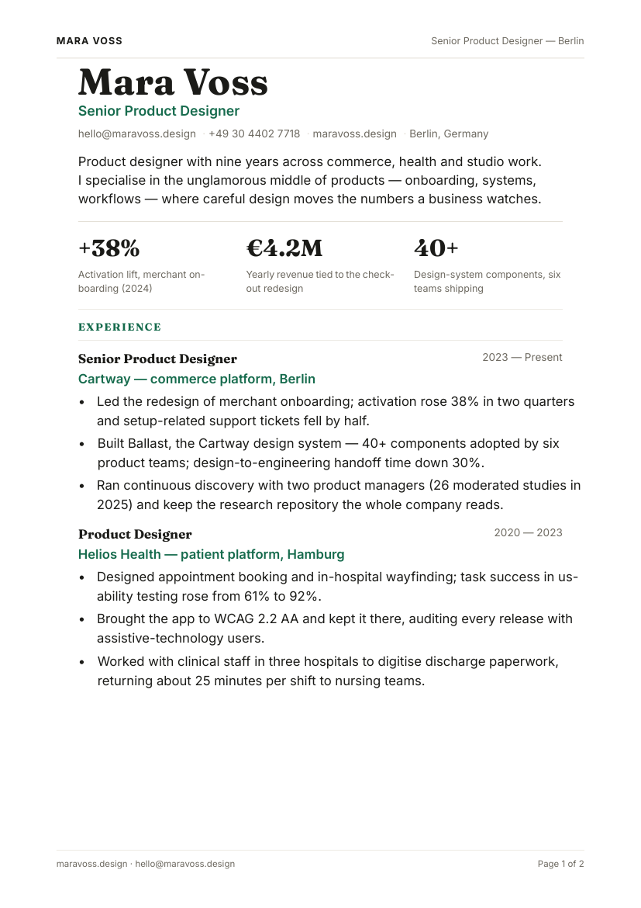
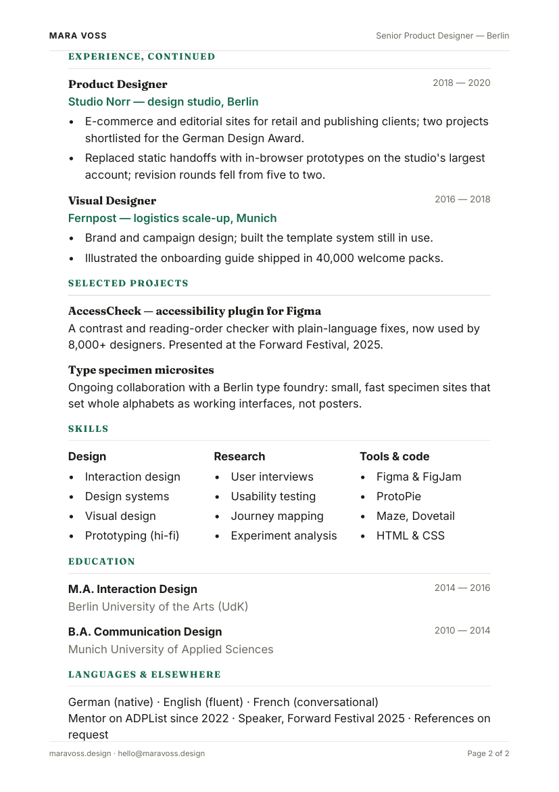

# Mara Voss — designer résumé (Document → PDF)

A two-page A4 résumé for **Mara Voss**, a fictional senior product designer: name and contact block, a summary, a metrics band, four roles with dated entries, selected projects, a three-column skills grid, education and languages. Built entirely with [Hyper Elements](https://hyperelements.dev) as a single `<Document>` template that renders both to print HTML and to a real PDF — no browser involved in the PDF.





The PDF itself is committed as [`preview.pdf`](preview.pdf). The same template also renders as print HTML (`preview-html.png` / `preview-html-mobile.png` in this repo).

## Run it

```bash
npm install
npm run render     # validates, then writes out/resume.html, out/resume.pdf and out/resume.txt
npm run check      # the Hyper Elements CLI check on the template
node scripts/screenshot.mjs out/resume.html preview-html   # screenshots the print HTML (needs a Playwright Chromium build)
```

**Checks:** `hyper-elements check` reports **0 errors, 0 warnings**. `validate()` inside `src/render.tsx` prints no diagnostics, the PDF is exactly two A4 pages, and the print HTML loads with a clean console.

## How Hyper Elements was used

- **One `<Document>`, two explicit pages.** The template (`src/resume.tsx`) is a single `<Document size="A4">` with two `<Document.Page>`s and a `<PageBreak>`, so the page split is designed, not left to chance: page 1 carries the current roles, page 2 the earlier ones plus projects, skills and education.
- **Running furniture with live page numbers.** A `<PageHeader>` (name + role) and `<PageFooter>` (site + `Page <PageNumber /> of <PageNumber total />`) repeat on every page; the numbers are the library's own `PageNumber` components, resolved at render time.
- **A theme carries the typography.** `defineTheme` sets an ink-and-paper palette with a deep-green accent, Fraunces for display type and Inter for body text, a `Heading` scale via `components.Heading.by.level`, and component defaults for `Text`, `List` and `Divider` — so every section inherits the same voice.
- **Two typed custom components**, defined with `component()` and validated like the built-ins:
  - `voss.SectionHeading` — the letter-spaced small-caps section label with its hairline rule.
  - `voss.Metric` — a Fraunces display numeral with a muted caption, used for the metrics band (+38% activation, €4.2M revenue, 40+ components).
- **A real PDF, rendered in-process.** `src/render.tsx` calls `renderPdf()` from `@hyper-elements/react/pdf` with the font files passed as bytes (from `assets/fonts/` — Inter and Fraunces, both SIL Open Font License), so the PDF embeds the same faces the HTML uses, with no browser, no network and a deterministic result. The print HTML from `render()` is written alongside it.
- **Data-driven content.** Roles and skill groups are plain arrays at the top of the template; each role block (title, right-aligned dates, company line, bullet list) is mapped from data, so swapping in a real person's history is a data edit, not a layout edit.
- **A deliberate measure.** Body content sits in a 600px column centred on the page — a comfortable reading width with generous margins, and enough headroom that the PDF renderer's longest lines always land inside the page.

## Make it yours

- **Your history:** replace the `roles` and `skills` arrays and the header/summary text in `src/resume.tsx`.
- **Retint:** change the theme tokens (`primary` is the green accent) and every heading, rule and company line follows.
- **Change fonts:** drop TTFs into `assets/fonts/`, update the two font stacks in the theme and the font list in `src/render.tsx`.

## Files

- `src/resume.tsx` — the template (theme, custom components, both pages)
- `src/render.tsx` — validate → render print HTML + PDF (fonts as bytes)
- `assets/fonts/` — Inter and Fraunces TTFs (SIL OFL), embedded into the PDF
- `scripts/screenshot.mjs` — headless-Chromium screenshots of the print HTML
- `preview-1.png`, `preview-2.png` — the two PDF pages, rasterised
- `preview.pdf` — the rendered PDF

MIT licensed.
